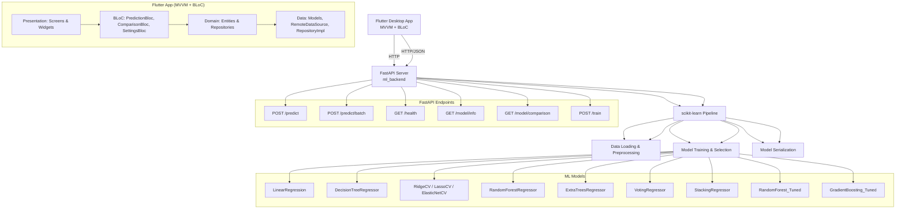

# HomeValue

End-to-end machine learning project for house price prediction using the California
Housing dataset. Implements a complete ML pipeline (preprocessing, feature engineering,
model training, regularization, ensembles, tuning) with scikit-learn, exposed via
FastAPI. Linux desktop GUI built with Flutter following MVVM + BLoC. Course project for
Advanced Machine Learning (Weeks 02-05).

> **Status — All Phases Complete.** The ML backend, Flutter desktop app, and integration tests are fully implemented. See [CHANGELOG.md](CHANGELOG.md) for details.

## Screenshots

| Prediction Screen | Model Comparison | Settings |
|:-----------------:|:----------------:|:--------:|
|  |  |  |

*Screenshots are placeholders — run the app to see the actual UI.*

## Architecture



## Implemented Features

### ML Backend (Python/FastAPI)
- **Data Loading**: California Housing (MedHouseVal) and Ames Housing (SalePrice) with verified parquet cache + SHA-256 sidecar
- **Preprocessing**: Median imputation, StandardScaler, polynomial features (degree=2), feature selection (SelectKBest, k=20)
- **Baseline Models**: LinearRegression, DecisionTreeRegressor
- **Regularized Models**: RidgeCV, LassoCV, ElasticNetCV with CV
- **Ensemble Models**: RandomForest, ExtraTrees, Voting, Stacking Regressors
- **Tuned Models**: RandomForest (RandomizedSearchCV), GradientBoosting (RandomizedSearchCV)
- **Model Selection**: RMSE-based best model selection, joblib serialization
- **FastAPI Endpoints**: `/predict`, `/predict/batch`, `/health`, `/model/info`, `/model/comparison`, `/train`
- **Tests**: 246 tests, 95.6% coverage

### Flutter Desktop App (Linux)
- **Architecture**: MVVM + BLoC with GetIt dependency injection
- **Prediction Screen**: Form with 8 numeric fields + ocean proximity dropdown, validation, result dialog with price formatting
- **Model Comparison**: Bar charts (fl_chart), metric selector (RMSE/MAE/R²/CV Std), data table, best model highlighted
- **Settings**: Server URL, theme mode (system/light/dark) with dynamic switching, auto-retrain toggle, SharedPreferences persistence
- **Navigation**: GoRouter with app bar actions for Settings and Model Comparison
- **Theming**: Material 3, light/dark mode, dynamic theme via SettingsBloc
- **Tests**: 52 Flutter tests (BLoC, widget, integration)

### Integration Tests
- Python: Full pipeline test, model persistence, API endpoint tests
- Flutter: Integration test with live FastAPI server

## Quick Start

### Prerequisites
- Python 3.11+
- Flutter 3.44+ with Linux desktop support (`flutter config --enable-linux-desktop`)

### Backend
```bash
cd ml_backend
pip install -e ".[dev]"
make test             # pytest with branch coverage
make train            # Train model and save to models/
make serve            # Start FastAPI server on http://localhost:8000
```

### Frontend
```bash
# From repository root
flutter pub get
flutter run -d linux
```

### Run All Tests
```bash
# Backend
cd ml_backend && make test

# Flutter
flutter test

# Integration (requires trained model and running server)
./scripts/e2e_test.sh
```

## API Documentation

### Base URL
`http://localhost:8000`

### Endpoints

| Method | Endpoint | Description |
|--------|----------|-------------|
| POST | `/predict` | Single house price prediction |
| POST | `/predict/batch` | Batch predictions |
| GET | `/health` | Health check |
| GET | `/model/info` | Model metadata |
| GET | `/model/comparison` | Model comparison metrics |
| POST | `/train` | Train and save best model |

### Request/Response Examples

**Single Prediction:**
```bash
curl -X POST http://localhost:8000/predict \
  -H "Content-Type: application/json" \
  -d '{
    "MedInc": 8.3252,
    "HouseAge": 41.0,
    "AveRooms": 6.984127,
    "AveBedrms": 1.02381,
    "Population": 322.0,
    "AveOccup": 2.555556,
    "Latitude": 37.88,
    "Longitude": -122.23,
    "ocean_proximity": "NEAR BAY"
  }'
```

**Response:**
```json
{
  "prediction": 4.52,
  "model": "RandomForestRegressor",
  "model_version": "1.0.0"
}
```

**Batch Prediction:**
```bash
curl -X POST http://localhost:8000/predict/batch \
  -H "Content-Type: application/json" \
  -d '{
    "features": [
      {"MedInc": 8.3252, "HouseAge": 41.0, "AveRooms": 6.984, "AveBedrms": 1.023, "Population": 322.0, "AveOccup": 2.555, "Latitude": 37.88, "Longitude": -122.23, "ocean_proximity": "NEAR BAY"},
      {"MedInc": 4.5, "HouseAge": 25.0, "AveRooms": 5.0, "AveBedrms": 1.2, "Population": 500.0, "AveOccup": 3.0, "Latitude": 34.0, "Longitude": -118.0, "ocean_proximity": "INLAND"}
    ]
  }'
```

**Model Info:**
```bash
curl http://localhost:8000/model/info
```

**Model Comparison:**
```bash
curl http://localhost:8000/model/comparison
```

**Train Model:**
```bash
curl -X POST http://localhost:8000/train
```

## Data Layer Usage

```python
from ml_backend.data.explore import explore_dataset, save_exploration_plots
from ml_backend.data.loader import load_california_housing, load_ames_housing

X, y = load_california_housing()      # 8 numeric features + MedHouseVal
X_ames, y_ames = load_ames_housing()  # 80 features + SalePrice

stats = explore_dataset(X)
save_exploration_plots(X.assign(MedHouseVal=y), target_col="MedHouseVal")
```

Dataset caches live in `data/` at the repository root (git-ignored). Set
`HOMEVALUE_ROOT` to override the root detected from the checkout.

Plotting is optional and requires the `viz` extra:
```bash
pip install -e "ml_backend[viz]"
```

## Preprocessing Usage

```python
from ml_backend.config import Config
from ml_backend.data.loader import load_california_housing
from ml_backend.preprocessing import (
    build_preprocessing_pipeline,
    infer_feature_types,
    split_train_test,
)

X, y = load_california_housing()
X_train, X_test, y_train, y_test = split_train_test(X, y, Config())

numeric, categorical = infer_feature_types(X_train)
pipeline = build_preprocessing_pipeline(numeric, categorical)
X_train_encoded = pipeline.fit_transform(X_train)
X_test_encoded = pipeline.transform(X_test)
```

## Model Training Usage

```python
from ml_backend.config import Config
from ml_backend.models import (
    train_baselines, train_regularized, train_ensembles,
    tune_random_forest, tune_gradient_boosting,
    evaluate_model, select_best_model, save_model, load_model,
)

config = Config()
X_train, X_test, y_train, y_test = ...

# Train all model types
baselines = train_baselines(X_train, y_train, config)
regularized = train_regularized(X_train, y_train, config)
ensembles = train_ensembles(X_train, y_train, config, base_estimators=None)

# Hyperparameter tuning
rf_search = tune_random_forest(X_train, y_train, config)
gb_search = tune_gradient_boosting(X_train, y_train, config)

# Evaluate and select best
all_models = {**baselines, **regularized, **ensembles}
best_name, best_model = select_best_model(all_models, X_test, y_test)

# Save best model
save_model(best_model, Path("models/best_model.joblib"))
```

## Flutter App Architecture (MVVM + BLoC)

```
lib/
├── core/
│   ├── di.dart              # GetIt dependency injection
│   ├── routing/app_router.dart  # GoRouter configuration
│   └── theme.dart           # Material 3 light/dark themes
├── features/
│   ├── prediction/
│   │   ├── domain/
│   │   │   ├── entities/          # HouseFeatures, PredictionResult, OceanProximity
│   │   │   └── repositories/      # PredictionRepository interface
│   │   ├── data/
│   │   │   ├── models/            # HouseFeaturesModel, PredictionResultModel
│   │   │   ├── datasources/       # PredictionRemoteDataSource (HTTP)
│   │   │   └── repositories/      # PredictionRepositoryImpl
│   │   └── presentation/
│   │       ├── bloc/              # PredictionBloc, Events, States
│   │       ├── screens/           # HomeScreen
│   │       └── widgets/           # FeatureInputField, ModelSelector, PredictionResultCard
│   ├── comparison/
│   │   ├── domain/                # ModelMetric, ModelComparison
│   │   ├── data/                  # Models, DataSource, Repository
│   │   └── presentation/          # ComparisonBloc, ComparisonScreen, MetricChart, ModelMetricTile
│   └── settings/
│       ├── domain/                # AppSettings
│       ├── data/                  # SettingsLocalDataSource (SharedPreferences), Repository
│       └── presentation/          # SettingsBloc, SettingsScreen
└── main.dart                    # App entry with MultiBlocProvider
```

### Key Patterns

- **BLoC Events/States**: Immutable, Equatable, part of bloc library
- **Repository Pattern**: Interface in domain, implementation in data
- **RemoteDataSource**: HTTP calls to FastAPI, returns domain models
- **Dependency Injection**: GetIt registers all singletons/factories at startup
- **Theme Management**: SettingsBloc provides dynamic theme mode to MaterialApp

## Release Build

```bash
# From ml_backend directory
make release

# Produces:
# - ml_backend/models/homevalue_best_model.joblib
# - build/linux/x64/release/bundle/ (Flutter Linux release bundle)
```

## CI/CD Pipeline

GitHub Actions workflow (`.github/workflows/ci.yml`):
- **Python Backend**: Matrix (3.11, 3.12) → format → lint → type check → test → coverage
- **Flutter App**: Format → analyze → test → build linux release
- **Integration Tests**: Train model → start server → run Flutter integration tests

## Course Coverage (Weeks 02-05)

| Week | Topics | Location |
|------|--------|----------|
| 02-03 | End-to-end ML pipeline, data prep, model selection, CV, GridSearch | `ml_backend/src/ml_backend/data/`, `preprocessing/`, `models/` |
| 04 | Polynomial Regression, Bias/Variance, Regularization (Ridge, Lasso, ElasticNet) | `ml_backend/src/ml_backend/models/regularized.py` |
| 05 | Ensemble Learning (Voting, Bagging, Random Forests, Boosting, Stacking) | `ml_backend/src/ml_backend/models/ensembles.py` |

## License

MIT License — course project for educational purposes. See [LICENSE](LICENSE).