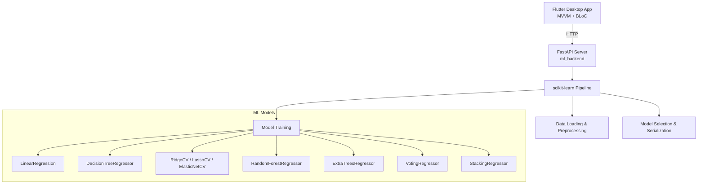

# HomeValue

End-to-end machine learning project for house price prediction using the California
Housing dataset. Implements a complete ML pipeline (preprocessing, feature engineering,
model training, regularization, ensembles, tuning) with scikit-learn, exposed via
FastAPI. Linux desktop GUI built with Flutter following MVVM + BLoC. Course project for
Advanced Machine Learning (Weeks 02-05).

> **Status — Phase 3 (models).** The ML data layer, preprocessing pipeline, baseline models (LinearRegression, DecisionTreeRegressor), regularized models (RidgeCV, LassoCV, ElasticNetCV), evaluation metrics (RMSE/MAE/R² + 5-fold CV), and config-driven hyperparameters are implemented. Ensembles, hyperparameter tuning, the FastAPI service, and the Flutter UI are roadmap items below.

## Architecture



## Implemented in Phases 1-3

- **Data loading**: California Housing (`MedHouseVal`) and Ames Housing (`SalePrice`).
- **Verified cache**: parquet files with a SHA-256 sidecar that detects accidental
  corruption; unverified or corrupted caches are discarded and refetched. The sidecar
  is local integrity only and is not a tamper-proof trust anchor.
- **Exploration**: dataset statistics (shape, dtypes, missing values, correlations,
  categorical summaries) and optional distribution/correlation/missing-value plots.
- **Preprocessing**: median numeric imputation, most-frequent categorical imputation,
  `StandardScaler`, full-level one-hot encoding with unseen-category tolerance, and
  non-redundant California ratio features.
- **Data split**: reproducible, config-driven train/test split with index and size
  validation.
- **Baseline models**: `LinearRegression`, `DecisionTreeRegressor` (with configurable depth/leaf limits) wrapped in inference-ready pipelines.
- **Regularized models**: `RidgeCV`, `LassoCV`, `ElasticNetCV` with config-driven alpha/l1_ratio grids and convergence monitoring.
- **Evaluation**: RMSE, MAE, R² metrics and 5-fold cross-validation with configurable scoring.
- **CI**: formatting, linting, typing, tests, Linux desktop build on every branch.
- **CD**: tag-driven release on `master`, builds the Python wheel and Linux bundle.

## Roadmap

| Phase | Scope |
|-------|-------|
| 2 | Preprocessing pipeline, feature engineering, train/test split |
| 3 | Baseline + regularized models (Ridge/Lasso/ElasticNet), cross-validation |
| 4 | Ensembles (Voting, Bagging, Random Forest, Extra Trees, Boosting, Stacking), tuning |
| 5 | FastAPI endpoints (`/predict`, `/predict_batch`, `/health`, `/model_info`, `/model_comparison`, `/train`) |
| 6 | Flutter Linux desktop UI (MVVM + BLoC): input form, model selector, charts |

## Quick Start

### Prerequisites
- Python 3.11+
- Flutter 3.44+ with Linux desktop support (`flutter config --enable-linux-desktop`)

### Backend
```bash
cd ml_backend
pip install -e ".[dev]"
make test             # pytest with branch coverage
```

Training and serving targets are stubs until phase 3/5:

```bash
make train            # exits with a roadmap message
make serve            # exits with a roadmap message
```

### Frontend
```bash
# From repository root (scaffold only until phase 6)
flutter pub get
flutter run -d linux
```

## Data Layer Usage

```python
from ml_backend.data.explore import explore_dataset, save_exploration_plots
from ml_backend.data.loader import load_california_housing, load_ames_housing

X, y = load_california_housing()      # 8 numeric features + MedHouseVal
X_ames, y_ames = load_ames_housing()  # 80 features + SalePrice

stats = explore_dataset(X)
save_exploration_plots(X.assign(MedHouseVal=y), target_col="MedHouseVal")
```

Dataset caches live in `data/` at the repository root (git-ignored). Set
`HOMEVALUE_ROOT` to override the root detected from the checkout.

Plotting is optional and requires the `viz` extra:

```bash
pip install -e "ml_backend[viz]"
```

## Preprocessing Usage

```python
from ml_backend.config import Config
from ml_backend.data.loader import load_california_housing
from ml_backend.preprocessing import (
    build_preprocessing_pipeline,
    infer_feature_types,
    split_train_test,
)

X, y = load_california_housing()
X_train, X_test, y_train, y_test = split_train_test(X, y, Config())

numeric, categorical = infer_feature_types(X_train)
pipeline = build_preprocessing_pipeline(numeric, categorical)
X_train_encoded = pipeline.fit_transform(X_train)  # fit on training data only
X_test_encoded = pipeline.transform(X_test)
```

Feature engineering runs automatically when the four California source columns are
declared as numeric features; pass `feature_engineering=False` to disable it. A
partial declaration raises unless engineering is explicitly disabled. Because the
bundled dataset stores per-household averages, the pipeline derives
`rooms_per_person`, `bedrooms_per_room`, and `households` instead of duplicating
`AveRooms`/`AveOccup`. Category levels are not dropped, so an unseen category
encodes as an all-zero block rather than colliding with a reference level.

## Model Training Usage

```python
from ml_backend.config import Config
from ml_backend.models import train_baselines, train_regularized, cross_validate_model

config = Config()
baselines = train_baselines(X_train_encoded, y_train, config)
regularized = train_regularized(X_train_encoded, y_train, config)

# Evaluate on test set
from ml_backend.models import evaluate_model
for name, pipeline in {**baselines, **regularized}.items():
    metrics = evaluate_model(pipeline, X_test_encoded, y_test)
    print(f"{name}: RMSE={metrics['rmse']:.3f}, MAE={metrics['mae']:.3f}, R²={metrics['r2']:.3f}")

# Cross-validation
cv_results = cross_validate_model(regularized["RidgeCV"], X_train_encoded, y_train, cv=5)
print(f"RidgeCV CV RMSE: {cv_results['cv_rmse_mean']:.3f} ± {cv_results['cv_rmse_std']:.3f}")
```

Model training uses the same preprocessing pipeline for inference-time compatibility.
Decision trees have configurable depth/leaf limits to prevent overfitting.
LassoCV and ElasticNetCV include convergence monitoring via configurable max_iter.

## Project Structure

```
HomeValue/
├── lib/                          # Flutter app (scaffold; MVVM + BLoC in phase 6)
├── test/                         # Flutter tests
├── ml_backend/                   # Python ML backend
│   ├── src/ml_backend/
│   │   ├── config.py
│   │   ├── data/                 # loaders + exploration (phase 1)
│   │   └── preprocessing/        # feature engineering, pipeline, split (phase 2)
│   ├── tests/
│   ├── pyproject.toml
│   ├── Makefile
│   └── README.md
├── .github/workflows/            # CI + tagged release
├── data/                         # git-ignored dataset cache
├── docs/followups.md
├── pubspec.yaml
├── analysis_options.yaml
├── CHANGELOG.md
└── README.md
```

## Course Coverage (Weeks 02-05)

| Week | Topics | Planned location |
|------|--------|------------------|
| 02-03 | End-to-end ML pipeline, data prep, model selection, CV, GridSearch | `ml_backend/src/ml_backend/data/`, `preprocessing/`, `models/` |
| 04 | Polynomial Regression, Bias/Variance, Regularization (Ridge, Lasso, ElasticNet) | `ml_backend/src/ml_backend/models/regularized.py` |
| 05 | Ensemble Learning (Voting, Bagging, Random Forests, Boosting, Stacking) | `ml_backend/src/ml_backend/models/ensembles.py` |

## License

MIT License — course project for educational purposes. See [LICENSE](LICENSE).
