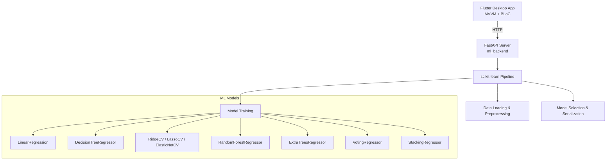

# HomeValue

End-to-end machine learning project for house price prediction using California Housing dataset. Implements complete ML pipeline (data preprocessing, feature engineering, model training, regularization, ensemble methods, hyperparameter tuning) with scikit-learn, exposed via FastAPI. Linux desktop GUI built with Flutter 3.x following MVVM + BLoC architecture. Course project for Advanced Machine Learning (Weeks 02-05).

## Architecture



## Features

- **Data Pipeline**: California Housing + Ames Housing datasets, feature engineering (rooms_per_household, bedrooms_per_room, population_per_household)
- **Models**: Linear, Decision Tree, Ridge, Lasso, ElasticNet, Random Forest, Extra Trees, Voting, Stacking
- **Regularization**: Ridge (L2), Lasso (L1), ElasticNet with cross-validation
- **Ensembles**: Bagging, Voting, Stacking with cross-validated base estimators
- **Hyperparameter Tuning**: RandomizedSearchCV for Random Forest & Gradient Boosting
- **API**: FastAPI with `/predict`, `/predict_batch`, `/model_info`, `/model_comparison`, `/health`, `/train`
- **GUI**: Flutter desktop (Linux) with feature input form, model selector, prediction display, comparison charts

## Quick Start

### Prerequisites
- Python 3.11+
- Flutter 3.22+ (with Linux desktop support: `flutter config --enable-linux-desktop`)
- uv or pip

### Backend Setup
```bash
cd ml_backend
make install          # Install Python dependencies
make train            # Train models and save best to models/
make serve            # Start FastAPI server on http://localhost:8000
```

### Frontend Setup
```bash
# From repository root
flutter pub get       # Install Dart dependencies
flutter run -d linux  # Run Flutter app on Linux desktop
```

### Development
```bash
# Backend
cd ml_backend
make format           # Format with black + ruff
make lint             # Lint with ruff + mypy
make test             # Run tests

# Frontend (from repo root)
dart format --set-exit-if-changed .
flutter analyze
flutter test
```

## API Endpoints

| Method | Endpoint | Description |
|--------|----------|-------------|
| POST | `/predict` | Single prediction |
| POST | `/predict_batch` | Batch predictions |
| GET | `/health` | Health check |
| GET | `/model_info` | Current model metadata |
| GET | `/model_comparison` | All models' metrics |
| POST | `/train` | Trigger full retrain |

### Prediction Request
```json
{
  "MedInc": 8.3252,
  "HouseAge": 41.0,
  "AveRooms": 6.9841,
  "AveBedrooms": 1.0238,
  "Population": 322.0,
  "AveOccup": 2.5556,
  "Latitude": 37.88,
  "Longitude": -122.23,
  "ocean_proximity": "NEAR BAY"
}
```

### Prediction Response
```json
{
  "prediction": 4.526,
  "model": "RandomForestRegressor",
  "model_version": "2026-10-22T10:30:00Z"
}
```

## Project Structure

```
HomeValue/
├── lib/                          # Flutter app (MVVM + BLoC)
│   ├── main.dart
│   ├── core/
│   │   ├── theme.dart
│   │   ├── constants.dart
│   │   ├── di.dart
│   │   └── routing/app_router.dart
│   └── features/
│       ├── prediction/
│       ├── comparison/
│       └── settings/
├── test/                         # Flutter tests
├── integration_test/             # Flutter integration tests
├── ml_backend/                   # Python ML backend
│   ├── src/ml_backend/
│   │   ├── config.py
│   │   ├── data/
│   │   ├── preprocessing/
│   │   ├── models/
│   │   └── api/
│   ├── tests/
│   ├── models/                   # Saved .joblib models
│   ├── data/                     # Cached datasets
│   ├── pyproject.toml
│   └── Makefile
├── pubspec.yaml
├── analysis_options.yaml
├── CHANGELOG.md
└── README.md
```

## Course Coverage (Weeks 02-05)

| Week | Topics | Implementation |
|------|--------|----------------|
| 02-03 | End-to-end ML pipeline, data prep, model selection, CV, GridSearch | `ml_backend/src/ml_backend/data/`, `preprocessing/`, `models/baselines.py`, `models/evaluation.py` |
| 04 | Polynomial Regression, Bias/Variance, Regularization (Ridge, Lasso, ElasticNet) | `ml_backend/src/ml_backend/models/regularized.py` |
| 05 | Ensemble Learning (Voting, Bagging, Random Forests, Boosting, Stacking) | `ml_backend/src/ml_backend/models/ensembles.py`, `models/tuning.py` |

## License

MIT License — Course project for educational purposes.
