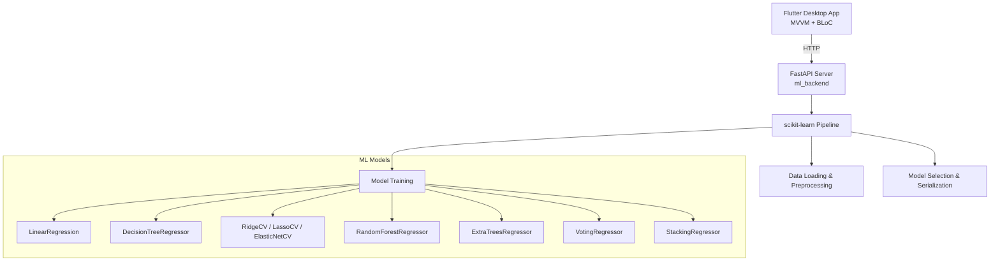

# HomeValue

End-to-end machine learning project for house price prediction using the California
Housing dataset. Implements a complete ML pipeline (preprocessing, feature engineering,
model training, regularization, ensembles, tuning) with scikit-learn, exposed via
FastAPI. Linux desktop GUI built with Flutter following MVVM + BLoC. Course project for
Advanced Machine Learning (Weeks 02-05).

> **Status — Phase 1 (foundation).** The ML data layer (California + Ames loaders,
> verified parquet cache, exploratory analysis) and CI/CD are implemented. Preprocessing,
> models, the FastAPI service, and the Flutter UI are roadmap items below and are not
> available yet.

## Architecture



## Implemented in Phase 1

- **Data loading**: California Housing (`MedHouseVal`) and Ames Housing (`SalePrice`).
- **Verified cache**: parquet files with a SHA-256 sidecar that detects accidental
  corruption; unverified or corrupted caches are discarded and refetched. The sidecar
  is local integrity only and is not a tamper-proof trust anchor.
- **Exploration**: dataset statistics (shape, dtypes, missing values, correlations,
  categorical summaries) and optional distribution/correlation/missing-value plots.
- **CI**: formatting, linting, typing, tests, Linux desktop build on every branch.
- **CD**: tag-driven release on `master`, builds the Python wheel and Linux bundle.

## Roadmap

| Phase | Scope |
|-------|-------|
| 2 | Preprocessing pipeline, feature engineering, train/test split |
| 3 | Baseline + regularized models (Ridge/Lasso/ElasticNet), cross-validation |
| 4 | Ensembles (Voting, Bagging, Random Forest, Extra Trees, Boosting, Stacking), tuning |
| 5 | FastAPI endpoints (`/predict`, `/predict_batch`, `/health`, `/model_info`, `/model_comparison`, `/train`) |
| 6 | Flutter Linux desktop UI (MVVM + BLoC): input form, model selector, charts |

## Quick Start

### Prerequisites
- Python 3.11+
- Flutter 3.44+ with Linux desktop support (`flutter config --enable-linux-desktop`)

### Backend
```bash
cd ml_backend
pip install -e ".[dev]"
make test             # pytest with branch coverage
```

Training and serving targets are stubs until phase 3/5:

```bash
make train            # exits with a roadmap message
make serve            # exits with a roadmap message
```

### Frontend
```bash
# From repository root (scaffold only until phase 6)
flutter pub get
flutter run -d linux
```

## Data Layer Usage

```python
from ml_backend.data.explore import explore_dataset, save_exploration_plots
from ml_backend.data.loader import load_california_housing, load_ames_housing

X, y = load_california_housing()      # 8 numeric features + MedHouseVal
X_ames, y_ames = load_ames_housing()  # 80 features + SalePrice

stats = explore_dataset(X)
save_exploration_plots(X.assign(MedHouseVal=y), target_col="MedHouseVal")
```

Dataset caches live in `data/` at the repository root (git-ignored). Set
`HOMEVALUE_ROOT` to override the root detected from the checkout.

Plotting is optional and requires the `viz` extra:

```bash
pip install -e "ml_backend[viz]"
```

## Project Structure

```
HomeValue/
├── lib/                          # Flutter app (scaffold; MVVM + BLoC in phase 6)
├── test/                         # Flutter tests
├── ml_backend/                   # Python ML backend
│   ├── src/ml_backend/
│   │   ├── config.py
│   │   └── data/                 # loaders + exploration (phase 1)
│   ├── tests/
│   ├── pyproject.toml
│   ├── Makefile
│   └── README.md
├── .github/workflows/            # CI + tagged release
├── data/                         # git-ignored dataset cache
├── docs/followups.md
├── pubspec.yaml
├── analysis_options.yaml
├── CHANGELOG.md
└── README.md
```

## Course Coverage (Weeks 02-05)

| Week | Topics | Planned location |
|------|--------|------------------|
| 02-03 | End-to-end ML pipeline, data prep, model selection, CV, GridSearch | `ml_backend/src/ml_backend/data/`, `preprocessing/`, `models/` |
| 04 | Polynomial Regression, Bias/Variance, Regularization (Ridge, Lasso, ElasticNet) | `ml_backend/src/ml_backend/models/regularized.py` |
| 05 | Ensemble Learning (Voting, Bagging, Random Forests, Boosting, Stacking) | `ml_backend/src/ml_backend/models/ensembles.py` |

## License

MIT License — course project for educational purposes. See [LICENSE](LICENSE).
